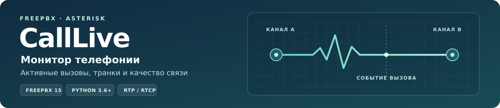
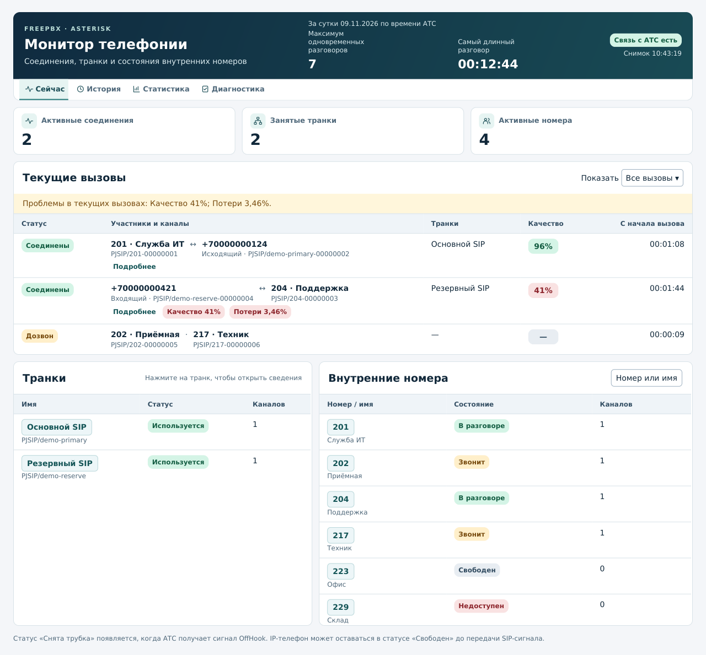
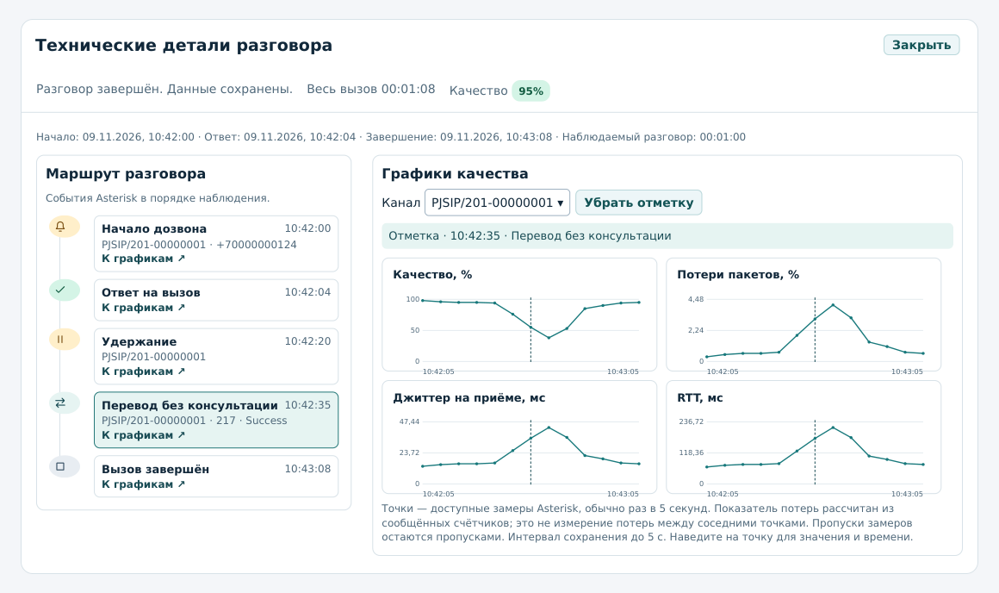
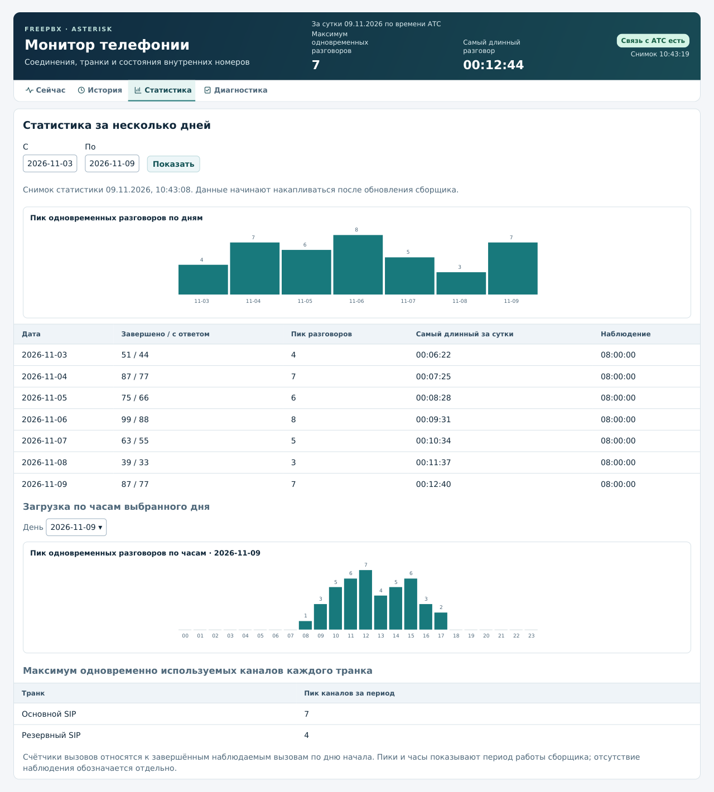
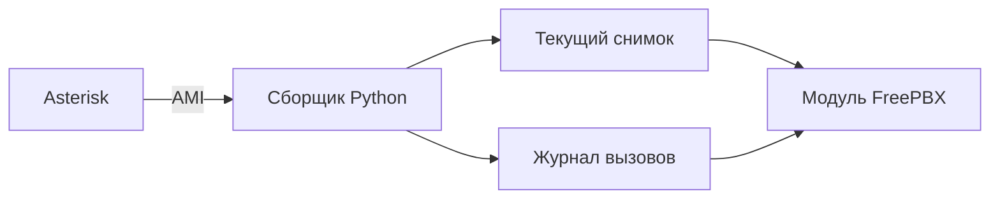

# CallLive для FreePBX 15



**CallLive** показывает, кто сейчас разговаривает, какие транки заняты и как меняется качество связи. Панель открывается в **Отчёты → Монитор телефонии**.

**Русская версия** · [English version](https://github.com/shayena84-byte/freepbx-calllive-en)

[Возможности](#возможности) · [Экраны](#экраны) · [Установка](#установка) · [Эксплуатация](#эксплуатация) · [Как устроен CallLive](#как-устроен-calllive)

**Установочный комплект [15.0.9](dist/15.0.9)** · **FreePBX 15 / Core** · **Asterisk 16 проверен на стенде** · **Linux / systemd / Python 3.6+**

## Возможности

| Раздел | Что можно увидеть |
| --- | --- |
| **Сейчас** | Участников и каналы текущих вызовов, состояния внутренних номеров, занятые транки и качество связи. В шапке видны суточный пик одновременных разговоров, самый длинный разговор и состояние связи с АТС. |
| **История** | Завершённые наблюдаемые вызовы с поиском по периоду, номеру или каналу и фильтром низкого качества. Карточку можно открыть повторно после отбоя. |
| **Детали разговора** | Маршрут с временем дозвона, ответа, удержания, перевода и завершения по доступным событиям Asterisk. Четыре графика показывают качество, потери пакетов, джиттер и RTT. Выбор события отмечает его время на графиках. |
| **Статистика** | Количество завершённых и отвеченных вызовов, дневные и часовые пики, самый длинный разговор за день и максимальную загрузку каналов каждого транка. |
| **Диагностика** | Версии модуля и сборщика, доступность AMI, давность снимка и состояние истории. Администратор видит команду обновления и может настроить общие пороги уведомлений. |

Из таблиц можно открыть карточки транков и внутренних номеров. Для внутренних номеров доступны DND, переадресации, Follow Me, устройства и регистрация, когда эти сведения есть на АТС. Уведомления в открытой панели выделяют устойчивые проблемы с качеством, потерями или долгим ожиданием.

## Экраны

Изображения показывают интерфейс версии 15.0.9 на демонстрационных данных.

### Сейчас



### Маршрут разговора и качество

Нажмите на событие, чтобы увидеть его отметку на четырёх графиках. CallLive выберет канал события, если по нему есть замеры. Для событий без измеренного канала доступен сводный вид. Пунктир показывает время события, точки показывают замеры Asterisk.



### Статистика



## Установка

Для установки возьмите архив конкретного релиза. Репозиторий закрытый, поэтому GitHub предложит войти в аккаунт с доступом.

| Файл комплекта 15.0.9 | Назначение |
| --- | --- |
| [freepbx15-calllive-15.0.9.tar.gz](dist/15.0.9/freepbx15-calllive-15.0.9.tar.gz) | Веб-модуль для загрузки в Module Admin |
| [calllive-15.0.9-update-root-command.txt](dist/15.0.9/calllive-15.0.9-update-root-command.txt) | Команда первого запуска сборщика или обновления с более ранней версии |
| [calllive-15.0.9-sign-root-command.txt](dist/15.0.9/calllive-15.0.9-sign-root-command.txt) | Полная команда локальной подписи для root-консоли |
| [calllive-15.0.9-sign-local.php](dist/15.0.9/calllive-15.0.9-sign-local.php) | Тот же код подписи отдельным PHP CLI-файлом |
| [SHA256SUMS.txt](dist/15.0.9/SHA256SUMS.txt) | Контрольные суммы файлов комплекта |

1. В FreePBX откройте **Администрирование → Module Admin → Upload Module**, загрузите архив и установите или обновите **Монитор телефонии**.
2. Вставьте полный текст команды локальной подписи в root-консоль. После успешной проверки подписи нажмите **Apply Config**.
3. Если сборщик **15.0.8** уже работает, переходите к проверке панели. При первой установке или со старым сборщиком выполните от root команду ниже.

   ```bash
   bash /var/www/html/admin/modules/calllive/deploy/update-root.sh
   ```

   Если каталог FreePBX отличается, используйте готовую команду из таблицы.
4. Откройте **Отчёты → Монитор телефонии → Диагностика**. Проверьте модуль **15.0.9**, сборщик **15.0.8**, совместимость, AMI и историю. Сделайте тестовый вызов и откройте его в истории после отбоя.

## Эксплуатация

- **Обновление.** Сборщик 15.0.4–15.0.7 нужно обновить до 15.0.8 для работы истории и статистики. Команда установки сохраняет настройки и выводит путь резервной копии вместе с командой отката. Перед обновлением можно вызвать `update-root.sh --check-only`. [Запуск, обновление и откат](docs/OPERATIONS_RU.md)
- **Подпись.** Подписывайте после установки файлов выбранного релиза. Команда сравнивает их контрольные суммы, использует локальный ключ и проверяет подпись через FreePBX. [Локальная подпись](docs/OPERATIONS_RU.md#подпись)
- **Доступ.** В **User Management → Administration GUI** разрешите вход в административный интерфейс, отключите полные права и выберите раздел **Монитор телефонии**. Это право открывает просмотр данных всей АТС. Общие пороги настраивает полный администратор. [Права пользователей](docs/OPERATIONS_RU.md#доступ-пользователя)
- **Хранение.** Снимок находится в `/run/freepbx-calllive`, история и статистика в `/var/lib/freepbx-calllive`. Значения по умолчанию — 30 календарных дней и до 512 МиБ архива. В истории сохраняются метаданные и доступные замеры RTP/RTCP. [Полное руководство](calllive/README_RU.md)

## Как устроен CallLive



Сборщик подключается к локальному AMI и работает под systemd. PHP-модуль использует сессию FreePBX, а браузер обновляет панель и строит графики из сохранённых данных. Замеры качества зависят от RTP/RTCP, доступных Asterisk. [Архитектура, схема журнала и API](docs/ARCHITECTURE_RU.md)

## Руководства

| Документ | Содержание |
| --- | --- |
| [Эксплуатация](docs/OPERATIONS_RU.md) | Установка, обновление, резервная копия, права доступа и подпись |
| [Руководство в архиве модуля](calllive/README_RU.md) | Требования, проверка службы, настройка и интерпретация качества |
| [Архитектура](docs/ARCHITECTURE_RU.md) | Поток данных, ключевые файлы, хранение и веб-API |
| [Проверка комплекта 15.0.9](docs/VALIDATION_15.0.9.md) | Переход с подписанной версии, действующий сборщик и проверка истории |
| [Проверка релиза 15.0.8](docs/VALIDATION_15.0.8.md) | Испытания на FreePBX 15 / Asterisk 16 и пределы проверки |

[Лицензия GPLv3+](calllive/LICENSE).
